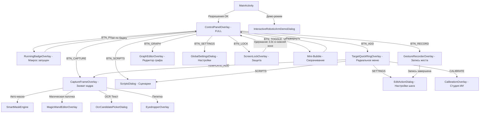

# УЛУЧШЕННАЯ КАРТА ВЗАИМОДЕЙСТВИЙ И АРХИТЕКТУРА ИНТЕРФЕЙСОВ AUTOTAP

## 📌 Оглавление и навигация
- [1. Глобальная матрица состояний и переходов (Mermaid Flowchart)](#1-глобальная-матрица-состояний-и-переходов)
- [2. Матрица контекстной видимости UI (Context-Aware Sanity Matrix)](#2-матрица-контекстной-видимости-ui)
- [3. Карта экранов с сквозными ID и привязкой к коду](#3-карта-экранов-с-сквозными-id-и-привязкой-к-коду)
  - [3.1 [SCR-MAIN] Главный экран (MainActivity)](#31-scr-main-главный-экран-mainactivity)
  - [3.2 [OVERLAY-CTRL] Плавающая панель управления (ControlPanelOverlay)](#32-overlay-ctrl-плавающая-панель-управления-controlpaneloverlay)
  - [3.3 [DLG-EDIT] Редактор шагов и жестов (EditActionDialog)](#33-dlg-edit-редактор-шагов-и-жестов-editactiondialog)
  - [3.4 [OVERLAY-GRAPH] Нодовый редактор графа (GraphEditorOverlay)](#34-overlay-graph-нодовый-редактор-графа-grapheditoroverlay)
  - [3.5 [DLG-SETT] Глобальные настройки (GlobalSettingsDialog)](#35-dlg-sett-глобальные-настройки-globalsettingsdialog)
  - [3.6 [DLG-SCRIPTS] Менеджер сценариев (ScriptsDialog)](#36-dlg-scripts-менеджер-сценариев-scriptsdialog)
  - [3.7 [OVERLAY-CAP] Захват кадра и ИИ-детекторы (CaptureFrameOverlay)](#37-overlay-cap-захват-кадра-и-ии-детекторы-captureframeoverlay)
  - [3.8 [DLG-DEMO] Интерактивное робо-демо (InteractiveRoboticArmDemoDialog)](#38-dlg-demo-интерактивное-робо-демо-interactiveroboticarmdemodialog)
  - [3.9 [OVERLAY-LOCK] Экран блокировки AMOLED (ScreenLockOverlay)](#39-overlay-lock-экран-блокировки-amoled-screenlockoverlay)
- [4. Алгоритмический тракт поиска OpenCV и каскадный мультипоиск](#4-алгоритмический-тракт-поиска-opencv-и-каскадный-мультипоиск)
- [5. Точечное обновление графов и сохранение макета](#5-точечное-обновление-графов-и-сохранение-макета)
- [6. Обработка исключений, сбоев и граничных условий (Edge Cases)](#6-обработка-исключений-сбоев-и-граничных-условий)
- [7. Физика тача, тайминги и тактильный отклик (Touch & Physicality)](#7-физика-тача-тайминги-и-тактильный-отклик)

---

## 1. Глобальная матрица состояний и переходов

---

## 2. Матрица контекстной видимости UI

| Компонент / Настройка | Клик / Удержание | Свайп / Траектория | Шаблон (Vision) | OCR Текст | Цвет (HSV) |
| :--- | :---: | :---: | :---: | :---: | :---: |
| **Длительность / Пауза (мс)** | ✅ (Нажатие) | ✅ (Движение) | ❌ Скрыто | ❌ Скрыто | ❌ Скрыто |
| **Степперы `[-10]...[+10]`** | ✅ | ✅ | ❌ Скрыто | ❌ Скрыто | ❌ Скрыто |
| **Контрольные точки траектории** | ❌ | ✅ | ❌ Скрыто | ❌ Скрыто | ❌ Скрыто |
| **Зона поиска (ROI)** | ❌ Скрыто | ❌ Скрыто | ✅ | ✅ | ✅ |
| **Порог точности (%)** | ❌ Скрыто | ❌ Скрыто | ✅ (Индивидуальный из JSON) | ✅ (ONNX) | ✅ (DeltaE) |
| **Таймаут поиска (мс)** | ❌ Скрыто | ❌ Скрыто | ✅ | ✅ | ✅ |
| **Ветвление УСПЕХ / СБОЙ** | ❌ Скрыто | ❌ Скрыто | ✅ | ✅ | ✅ |
| **Оповещение (Звук/Вибро)** | ❌ Скрыто | ❌ Скрыто | ✅ | ✅ | ✅ |

---

## 3. Карта экранов с сквозными ID и привязкой к коду

### 3.1 [SCR-MAIN] Главный экран (`MainActivity`)
- **Класс:** `com.example.autotap.presentation.main.MainActivity`
- **Функция:** Проверка системных прав и управление состоянием службы оверлея.
- **Элементы управления:**
  - `[CTRL-01] [BTN_TOGGLE_SERVICE]` — Кнопка запуска/остановки оверлея.
    - *Действие:* `AutoTapAccessibilityService.startOrStop()`.
  - `[CTRL-02] [BTN_OPEN_DEMO]` — Запуск демо-режима с роборукой.
    - *Действие:* Инициализация `InteractiveRoboticArmDemoDialog.show()`.
  - `[CTRL-03] [BTN_OPEN_SCRIPTS]` — Менеджер файлов сценариев.
    - *Действие:* Инициализация `ScriptsDialog.show()`.
  - `[CTRL-04] [BTN_OPEN_LOGS]` — Просмотр системного журнала.
    - *Действие:* Инициализация `LogViewerDialog.show()`.

### 3.2 [OVERLAY-CTRL] Плавающая панель управления (`ControlPanelOverlay`)
- **Класс:** `com.example.autotap.infrastructure.overlay.panel.ControlPanelOverlay`
- **Двухуровневая компоновка кнопок:**
  - **Ряд 1 (`mainRow`, слева направо)**:
    1. `[BTN_PLAY_VIEW]` — Пуск / Стоп макроса (зеленый/красный).
    2. `[BTN_CAPTURE]` — Вырезка ИИ-шаблона.
    3. `[BTN_RECORD]` — Запись живых жестов пальца.
    4. `[BTN_ADD]` — Добавить новую мишень `[+]`.
    5. `[BTN_TOGGLE_VIEW]` — Раскрыть/свернуть шторку.
    6. `[BTN_CLOSE]` — **Красный крестик `X` (на 1-м уровне справа)**.
  - **Ряд 2 (`subRow`, слева направо)**:
    1. `[BTN_SCRIPTS]` — Менеджер сценариев (JSON, ZIP).
    2. `[BTN_SETTINGS]` — Глобальные настройки.
    3. `[BTN_HIDE]` — Глаз скрытия меток.
    4. `[BTN_LOCK]` — AFK замок экрана.
    5. `[BTN_CLEAR]` — Корзина / Очистка мишеней.
    6. `[BTN_TUTORIAL]` — **Фиолетовая справка `?` (на 2-м уровне справа)**.

### 3.3 [OVERLAY-RING] Радиальное кольцо быстрого шага (`TargetQuickRingOverlay`)
- **Класс:** `com.example.autotap.infrastructure.overlay.ring.TargetQuickRingOverlay`
- **Состав кнопок меню кольца:**
  1. `SETTINGS` — Настройки шага.
  2. `SCRIPTS` — Менеджер сценариев (прямой переход к `ScriptsDialog`).
  3. `TEMPLATE_ADD` — Добавить маску / мультишаблон.
  4. `CALIBRATE` — ИИ-калибровка и студия.
  5. `PLUS` — Клонировать шаг.
  6. `DELETE` — Удалить шаг.

### 3.4 [DLG-EDIT] Редактор шагов и жестов (`EditActionDialog`)
- **Класс:** `com.example.autotap.infrastructure.overlay.dialog.EditActionDialog`
- **Особенности:**
  - Поддержка переименования шаблонов на русском языке (кириллица `\u0400-\u04FF`, пробелы и дефисы).
  - Атомарное обновление `displayName` в файле `.json` и связанных файлов `mask_*.png`, `raw_*.png`, `screen_*.png`.

### 3.5 [OVERLAY-GRAPH] Нодовый редактор графа (`GraphEditorOverlay`)
- **Класс:** `com.example.autotap.infrastructure.overlay.graph.GraphEditorOverlay`
- **Функционал:**
  - Визуальное редактирование DAG-графа: создание циклов, ветвлений и нелинейной логики.
  - Сохранение кастомных координат узлов (`canvasX`, `canvasY`) и связей (`edges`).

### 3.6 [OVERLAY-LOCK] Экран блокировки AMOLED (`ScreenLockOverlay`)
- **Класс:** `com.example.autotap.infrastructure.overlay.lock.ScreenLockOverlay`
- **Механика защиты**:
  - **AMOLED Eco**: Истинно черный фон `#000000` и системная яркость `screenBrightness = 0.01f`.
  - **100% Перехват нажатий**: Полноэкранный слой перехватывает все случайно сделанные касания человека (`setOnTouchListener { _, _ -> true }`).
  - **Динамический микро-проброс**: Во время работы макроса `GestureDispatcher` на 50–120 мс переключает `setPassthroughEnabled(true)` для отправки синтетического клика по игре и сразу возвращает блокировку.
  - **Разблокировка**: Намеренное зажатие нижней плашки ровно на **3.0 секунды** с заполнением шкалы и виброоткликом.

---

## 4. Алгоритмический тракт поиска OpenCV и каскадный мультипоиск

1. **100% Индивидуальный порог маски из JSON**:
   - В `TemplateMatchingEngine.kt` общий порог действия не перекрывает порог маски.
   - Порог сходимости `individualThreshold` считывается строго из параметров `.json` файла самой маски (`similarityPercent`, по умолчанию 75%).
2. **Запас 5% устойчивости от шума**:
   - К рассчитанному порогу маски применяется автоматический 5% запас устойчивости: `templateThreshold = (rawThreshold - 0.05f).coerceIn(0.55f, 0.98f)`.
   - Это обеспечивает надежное распознавание при сжатии кадров, антиалиасинге и сдвиге полутонов.
3. **Мгновенный ранний выход TIER 0 / TIER 1 (< 1 мс)**:
   - В режиме проигрывания макроса (`findAllMatches == false`), как только любая из масок мультипоиска находит совпадение по своей первичной якорной точке (TIER 0 / TIER 1), поиск мгновенно завершается (`return nmsFilter(allCandidates)`).
   - Кликер совершает моментальный динамический клик по **живым найденным координатам на экране** `(best.clickX + clickOffsetX, best.clickY + clickOffsetY)` и переходит к следующему шагу.
4. **Инвалидация кэша по штампу времени `.json`**:
   - Ключ `dynamicKey` содержит `metaLastMod` файла `.json`. При перекалибровке шаблона кэш дескрипторов моментально обновляется.

---

## 5. Точечное обновление графов и сохранение макета

1. **Targeted Node Update (`LinearToGraphMigrator.updateNodeForAction`)**:
   - При изменении параметров клика, добавлении маски или передвижении мишени на экране обновляется строго узел `node_${action.id}`.
   - **Сохранение макета**: Пользовательские координаты узла (`canvasX`, `canvasY`), кастомные связи (`edges`), ветвления и блоки циклов сохраняются на 100% без затирания графа.
2. **Точечная загрузка шаблонов (0 мс старт)**:
   - В `MacroExecutionEngine.kt` и `AutoTapOrchestrator.kt` вызовы глобального обхода диска `loadAllTemplates()` заменены на точечный резолвинг `resolveSingle(rawPath)` и `loadScenarioTemplates()`.
   - В память 64 МБ LRU-кэша загружаются **исключительно маски активного макроса**.
3. **Динамический клик в графе**:
   - Мультипоисковые триггеры в графе создаются с флагом `autoClickTarget = action.clickAiTarget`, выполняя динамический клик по реальным координатам найденной цели на экране.

---

## 6. Обработка исключений, сбоев и граничных условий (Edge Cases)

| Сбойная ситуация / Граничный случай | Реакция системы (System Behavior) | Восстановление и предотвращение |
| :--- | :--- | :--- |
| **Перемещение файла маски в другую подпапку** | `TemplateRepositoryImpl.resolveTemplatePath()` находит актуальный путь по имени файла. | Считывание `.json` метаданных и растра происходит без потерь. |
| **Вылет или закрытие целевого приложения** | Детекция `AppProfileDetector`. Поиск останавливается при смене пакета. | Макрос автоматически переходит в `PAUSED` и выдает уведомление. |
| **Поворот экрана (Landscape / Portrait)** | `CoordinateNormalizer` пересчитывает координаты нод в относительные проценты (0.0–1.0). | Оверлеи перерисовываются без сброса текущего прогресса. |
| **Заполнение памяти при 100+ шаблонах** | Память изолирована 64 МБ LruCache с алгоритмом `resolveSingle()`. | На диске не происходит сплошного вычитывания файлов. |

---

## 7. Физика тача, тайминги и тактильный отклик

1. **Touch Target Standard:** Все интерактивные кнопки панели имеют минимальную визуальную область от 32dp–38dp и увеличенную кликабельную зону от **48dp** (Material Accessibility standard).
2. **Дебаунс сохранений:** Асинхронная дебаунс-фиксация сессии в `persistActiveSession()` задерживается на **350 мс** для исключения спама на диск при перетаскивании мишеней.
3. **Тактильный отклик (Haptic Feedback):** Короткий виброотклик (25 мс) при зажатии разблокировки и пульс (60 мс) при успешном снятии AFK Замка.

---
*Документ автоматически валидирован исполняемыми тестами 1AInspector.*
